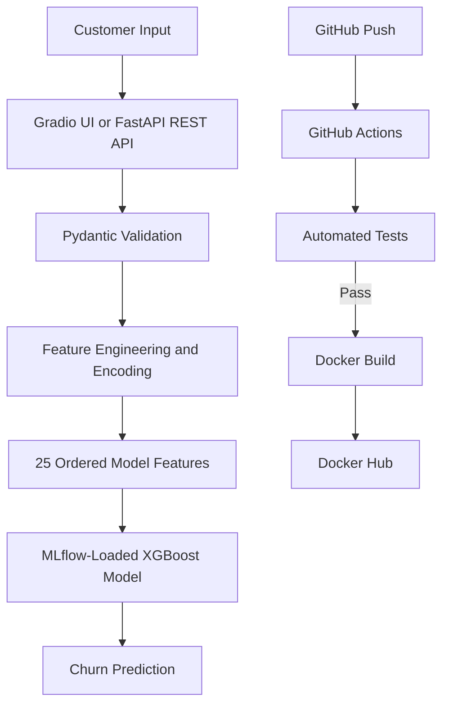

# Telco Customer Churn Prediction | End-to-End MLOps Project

An end-to-end machine learning application that predicts whether a telecom customer is likely to churn, using **XGBoost, MLflow, FastAPI, Gradio, Docker, and GitHub Actions**.

The project demonstrates a machine learning workflow from exploratory data analysis and model training through model serving, containerization, automated testing, and continuous integration and delivery (CI/CD).

## Project Overview

Customer churn is an important business challenge for telecommunications companies. Identifying customers who may leave helps businesses prioritize retention efforts.

This project uses customer demographic information, subscription services, contract details, and billing information to predict churn.

The application provides:

- An interactive **Gradio interface** for entering customer details.
- A **FastAPI REST endpoint** for programmatic predictions.
- An **XGBoost classification model** loaded through MLflow.
- Consistent preprocessing and feature engineering.
- A **Docker image** for reproducible deployment.
- **Six automated tests** using pytest.
- A **GitHub Actions CI/CD pipeline** that tests, builds, and publishes the Docker image.

## Technology Stack

| Category | Technologies |
|---|---|
| Programming | Python |
| Machine learning | XGBoost, scikit-learn |
| Data processing | Pandas, NumPy |
| Experiment tracking and model packaging | MLflow |
| REST API | FastAPI, Pydantic |
| User interface | Gradio |
| Containerization | Docker |
| CI/CD | GitHub Actions |
| Container registry | Docker Hub |
| Automated testing | pytest |

## System Architecture



**Inference flow:** Customer input is validated, transformed into the 25 features expected by the trained model, and passed to XGBoost.

**CI/CD flow:** GitHub Actions runs tests before building and publishing a new Docker image.

## Project Structure

```text
Churn/
├── .github/
│   └── workflows/
│       └── ci.yml
├── artifacts/
│   └── model/
│       ├── MLmodel
│       ├── model.xgb
│       └── feature_columns.txt
├── data/
│   └── raw/
├── notebooks/
│   └── Analysis.ipynb
├── src/
│   ├── app/
│   │   ├── main.py
│   │   ├── schemas.py
│   │   └── ui.py
│   └── serving/
│       ├── inference.py
│       └── preprocessing.py
├── tests/
│   └── test_app.py
├── Dockerfile
├── .dockerignore
├── .gitignore
├── requirements.txt
└── requirements-dev.txt
```

### Key Components

- `notebooks/Analysis.ipynb` — Exploratory analysis, model development, and evaluation.
- `src/app/main.py` — FastAPI application and Gradio mounting.
- `src/app/schemas.py` — Customer input validation using Pydantic.
- `src/app/ui.py` — Interactive Gradio interface.
- `src/serving/preprocessing.py` — Feature transformation and encoding.
- `src/serving/inference.py` — MLflow model loading and prediction.
- `artifacts/model/` — Deployable trained model and feature metadata.
- `tests/` — Automated application and preprocessing tests.
- `.github/workflows/ci.yml` — Continuous integration and delivery workflow.

## Machine Learning Pipeline

### Data preprocessing

The inference pipeline processes **19 raw customer attributes**, including:

- Customer demographics and senior citizen status.
- Phone and internet subscriptions.
- Online security, backup, device protection, and streaming services.
- Contract type and payment method.
- Tenure, monthly charges, and total charges.

Categorical features are encoded into numeric values, and special service availability features are engineered.

The processed data is aligned to the **25 ordered features** required by the trained XGBoost model.

### Model training and tracking

XGBoost is used to perform binary churn classification.

MLflow is used to package the trained model and manage the model artifacts required for inference.

The original training notebook is retained for analysis and reproducibility.

### Prediction output

The application returns one of two classifications:

- **Likely to churn**
- **Not likely to churn**

The current serving application uses the model's classification output. The training notebook also evaluates a churn probability threshold of `0.3`; that alternative decision rule has not been applied automatically to serving.

## Run the Published Docker Image

The application has been built and published to Docker Hub using GitHub Actions.

**Docker Hub image:** `mazraza05/telco-api:latest`

Pull the published image:

```bash
docker pull mazraza05/telco-api:latest
```

Start the container:

```bash
docker run --rm -p 8003:8000 mazraza05/telco-api:latest
```

Once the application starts, open:

| Service | URL |
|---|---|
| Gradio interface | http://127.0.0.1:8003/ui/ |
| FastAPI documentation | http://127.0.0.1:8003/docs |
| Health endpoint | http://127.0.0.1:8003/ |

The published Docker image has been tested locally with successful churn predictions.

## Local Development

### Requirements

- Python 3.12
- pip
- Docker (optional for local Python development)
- Trained MLflow model artifacts in `artifacts/model/`

### Create a virtual environment

From the project root in Windows PowerShell:

```powershell
py -3.12 -m venv .venv
.\.venv\Scripts\Activate.ps1
```

Install production dependencies:

```powershell
python -m pip install -r requirements.txt
```

Start FastAPI:

```powershell
python -m uvicorn src.app.main:app --reload --host 127.0.0.1 --port 8000
```

Open the Gradio interface at:

http://127.0.0.1:8000/ui/

### Build Docker locally

```bash
docker build -t telco-churn:local .
```

Run the local image:

```bash
docker run --rm -p 8002:8000 telco-churn:local
```

Open http://127.0.0.1:8002/ui/.

## FastAPI Prediction Endpoint

The REST API provides a `POST /predict` endpoint accepting customer information as JSON.

Example request:

```json
{
  "gender": "Male",
  "SeniorCitizen": 1,
  "Partner": "No",
  "Dependents": "No",
  "tenure": 2,
  "PhoneService": "No",
  "MultipleLines": "No phone service",
  "InternetService": "No",
  "OnlineSecurity": "No internet service",
  "OnlineBackup": "No internet service",
  "DeviceProtection": "No internet service",
  "TechSupport": "No internet service",
  "StreamingTV": "No internet service",
  "StreamingMovies": "No internet service",
  "Contract": "Month-to-month",
  "PaperlessBilling": "Yes",
  "PaymentMethod": "Electronic check",
  "MonthlyCharges": 20.0,
  "TotalCharges": 40.0
}
```

Example response format:

```json
{
  "prediction": "Likely to churn"
}
```

The example illustrates the response structure; the actual prediction is determined by the trained model.

The API represents `SeniorCitizen` as `0` or `1`, while the Gradio form displays user-friendly Yes/No options.

## Automated Testing

The application uses pytest to verify essential functionality.

The current test suite contains six checks:

1. FastAPI health endpoint responds successfully.
2. Gradio interface is mounted at `/ui`.
3. The trained model uses 25 expected features.
4. Preprocessing produces the correct feature structure.
5. The prediction endpoint returns a valid classification.
6. Invalid customer inputs are rejected.

Run tests locally:

```bash
python -m pip install -r requirements-dev.txt
python -m pytest tests/ -v
```

**Latest verified result: 6 tests passed.**

These tests validate application behavior and model-serving compatibility; they do not replace model-quality evaluation.

## GitHub Actions CI/CD

GitHub Actions automates testing and publishing the Docker image.

The workflow runs on pushes to the `main` branch and can be configured to validate pull requests.

### Pipeline

1. Checkout repository code.
2. Set up Python and install dependencies.
3. Run the automated pytest test suite.
4. Proceed only when tests pass.
5. Build the application Docker image.
6. Authenticate to Docker Hub.
7. Publish `mazraza05/telco-api:latest`.

The workflow uses two GitHub repository secrets:

- `DOCKERHUB_USERNAME`
- `DOCKERHUB_TOKEN`

**CI/CD status:** The automated test job and Docker publishing job have both completed successfully in GitHub Actions.

## Model Evaluation

The original notebook contains the training and evaluation workflow.

Before publishing performance claims, record the measured results from the notebook:

| Metric | Result |
|---|---|
| Accuracy | To be added |
| Precision | To be added |
| Recall | To be added |
| F1-score | To be added |
| ROC-AUC | To be added |

For churn prediction, recall is particularly relevant when the business goal is to identify customers at risk of leaving. Precision also matters because unnecessary retention interventions can create additional costs.

## Limitations and Future Improvements

- Validate production predictions against the original training preprocessing and evaluation pipeline.
- Document model performance with measured evaluation metrics.
- Add model drift monitoring and ongoing performance checks.
- Introduce model versioning and deployment rollback practices.
- Add secure public hosting if required.
- Consider evaluating alternative probability thresholds for customer retention use cases.

## Project Status

**Completed:**

- Machine learning model development and MLflow packaging.
- FastAPI prediction API.
- Interactive Gradio interface.
- Modular serving and preprocessing code.
- Docker containerization.
- Published Docker Hub image.
- Automated pytest tests.
- GitHub Actions CI/CD.

**Not yet completed:** Public cloud hosting, continuous model monitoring, and documented production performance metrics.

## About This Project

This project demonstrates practical skills in machine learning engineering and MLOps, including feature engineering, model serving, API development, containerization, testing, and CI/CD automation.

The goal is to bridge the gap between training a machine learning model and making it usable through a reproducible application deployment workflow.